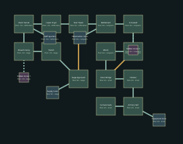

# Ash Approach — v13 design packet

Infiltrate the gatehouse and open the inner fortress gate.

Target: 20–25 minutes human first successful exploration, excluding deaths. No bot timing claim.

## Objective journey

1. Retrieve gatehouse credential in the crypt guard post.
2. Approach the gatehouse through the battlements and operate the bridge winch.
3. Cross the lowered bridge and enter Furnace Choir.

Open bridge exposes a crossfire courtyard; retreat remains possible. No kill-all gate.

These later-level diagrams establish identity and adjacency; resolve exact portal polylines, per-instance furnishings, encounter/supply numbers and collision at their subsequent construction milestone. They are not current playable replacements.

## Rooms and pre-build object list

| Room | Floor | Function | Objects |
|---|---:|---|---|
| Siege Approach | 0m | rampart | guard_table, weapon_rack, banner_standard |
| Trench | -2m | barricade | guard_table, weapon_rack, banner_standard |
| Breach Camp | -2m | guardhouse | guard_table, weapon_rack, banner_standard |
| Flank Tunnel | -2m | crypt | guard_table, weapon_rack, banner_standard |
| Lower Crypt | -2m | crypt | guard_table, weapon_rack, banner_standard |
| Stair Tower | 2m | guardhouse | guard_table, weapon_rack, banner_standard |
| Battlement | 6m | rampart | guard_table, weapon_rack, banner_standard |
| Crosswall | 6m | rampart | guard_table, weapon_rack, banner_standard |
| Gatehouse | 6m | guardhouse | guard_table, weapon_rack, banner_standard |
| Winch | 6m | forge | guard_table, weapon_rack, banner_standard |
| Inner Bridge | 2m | rampart | guard_table, weapon_rack, banner_standard |
| Cloister | 2m | chapel | guard_table, weapon_rack, banner_standard |
| Armory Hall | 2m | guardhouse | guard_table, weapon_rack, banner_standard |
| Furnace Gate | 2m | forge | guard_table, weapon_rack, banner_standard |
| Supply room (optional) | 0m | stores | guard_table, weapon_rack, banner_standard |
| Staff quarters (optional) | -2m | stores | guard_table, weapon_rack, banner_standard |
| Observation room (optional) | 6m | stores | guard_table, weapon_rack, banner_standard |
| Equipment store (optional) | 2m | stores | guard_table, weapon_rack, banner_standard |
| Hidden stores 1 (secret) | -2m | stores | guard_table, weapon_rack, banner_standard |
| Hidden stores 2 (secret) | 6m | stores | guard_table, weapon_rack, banner_standard |

Machine-readable positions, connections, requirements and inventory: `ash_citadel_01.json`.
