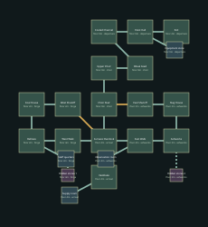

# Furnace Choir — v13 design packet

Extinguish the ritual furnaces and cross the cooled central channel.

Target: 20–25 minutes human first successful exploration, excluding deaths. No bot timing claim.

## Objective journey

1. Close the west fuel supply and east draft supply in either order.
2. The two shutdowns unlock the upper choir; destroy its ritual feed.
3. Cross the visibly cooled channel to the reliquary hoist.

Vertical crossing fight while machinery closes off a previous sightline; no instant damage floor required.

These later-level diagrams establish identity and adjacency; resolve exact portal polylines, per-instance furnishings, encounter/supply numbers and collision at their subsequent construction milestone. They are not current playable replacements.

## Rooms and pre-build object list

| Room | Floor | Function | Objects |
|---|---:|---|---|
| Vestibule | 4m | chapel | forge_hearth, anvil, chain_winch |
| Furnace Overlook | 4m | forge | forge_hearth, anvil, chain_winch |
| West Walk | 4m | forge | forge_hearth, anvil, chain_winch |
| Bellows | 2m | forge | forge_hearth, anvil, chain_winch |
| Coal House | 2m | guardhouse | forge_hearth, anvil, chain_winch |
| West Shutoff | 2m | forge | forge_hearth, anvil, chain_winch |
| East Walk | 4m | forge | forge_hearth, anvil, chain_winch |
| Ashworks | 2m | forge | forge_hearth, anvil, chain_winch |
| Slag House | 2m | forge | forge_hearth, anvil, chain_winch |
| East Shutoff | 2m | forge | forge_hearth, anvil, chain_winch |
| Choir Stair | 8m | chapel | forge_hearth, anvil, chain_winch |
| Upper Choir | 8m | chapel | forge_hearth, anvil, chain_winch |
| Ritual Feed | 8m | chapel | forge_hearth, anvil, chain_winch |
| Cooled Channel | 0m | forge | forge_hearth, anvil, chain_winch |
| Hoist Hall | 0m | crypt | forge_hearth, anvil, chain_winch |
| Exit | 4m | crypt | forge_hearth, anvil, chain_winch |
| Supply room (optional) | 4m | stores | forge_hearth, anvil, chain_winch |
| Staff quarters (optional) | 2m | stores | forge_hearth, anvil, chain_winch |
| Observation room (optional) | 4m | stores | forge_hearth, anvil, chain_winch |
| Equipment store (optional) | 0m | stores | forge_hearth, anvil, chain_winch |
| Hidden stores 1 (secret) | 4m | stores | forge_hearth, anvil, chain_winch |
| Hidden stores 2 (secret) | 2m | stores | forge_hearth, anvil, chain_winch |

Machine-readable positions, connections, requirements and inventory: `ash_citadel_02.json`.
