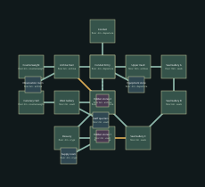

# Black Reliquary — v13 design packet

Unseal the transit conduit beneath the reliquary.

Target: 20–25 minutes human first successful exploration, excluding deaths. No bot timing claim.

## Objective journey

1. Raise the funerary counterweight to open the upper archive.
2. From three successive galleries, destroy the exposed vault seals.
3. Descend through the opened vault floor into the civic conduit.

Repeated views of the same central vault from new heights; fight changes when lower vault opens.

These later-level diagrams establish identity and adjacency; resolve exact portal polylines, per-instance furnishings, encounter/supply numbers and collision at their subsequent construction milestone. They are not current playable replacements.

## Rooms and pre-build object list

| Room | Floor | Function | Objects |
|---|---:|---|---|
| Crypt | -2m | crypt | reliquary, sarcophagus, scribe_desk |
| Ossuary | -2m | crypt | reliquary, sarcophagus, scribe_desk |
| Vault | 2m | chapel | reliquary, sarcophagus, scribe_desk |
| West Gallery | 2m | chapel | reliquary, sarcophagus, scribe_desk |
| Funerary Hall | 2m | crypt | reliquary, sarcophagus, scribe_desk |
| Counterweight | 6m | crypt | reliquary, sarcophagus, scribe_desk |
| Archive Stair | 6m | archive | reliquary, sarcophagus, scribe_desk |
| Scribe Archive | 6m | archive | reliquary, sarcophagus, scribe_desk |
| Upper Vault | 10m | chapel | reliquary, sarcophagus, scribe_desk |
| Seal Gallery A | 10m | chapel | reliquary, sarcophagus, scribe_desk |
| Seal Gallery B | 6m | chapel | reliquary, sarcophagus, scribe_desk |
| Seal Gallery C | 2m | crypt | reliquary, sarcophagus, scribe_desk |
| Lower Vault | -2m | crypt | reliquary, sarcophagus, scribe_desk |
| Conduit Entry | -2m | crypt | reliquary, sarcophagus, scribe_desk |
| Conduit | -2m | crypt | reliquary, sarcophagus, scribe_desk |
| Supply room (optional) | -2m | stores | reliquary, sarcophagus, scribe_desk |
| Staff quarters (optional) | 2m | stores | reliquary, sarcophagus, scribe_desk |
| Observation room (optional) | 6m | stores | reliquary, sarcophagus, scribe_desk |
| Equipment store (optional) | -2m | stores | reliquary, sarcophagus, scribe_desk |
| Hidden stores 1 (secret) | 2m | stores | reliquary, sarcophagus, scribe_desk |
| Hidden stores 2 (secret) | 6m | stores | reliquary, sarcophagus, scribe_desk |

Machine-readable positions, connections, requirements and inventory: `ash_citadel_03.json`.
