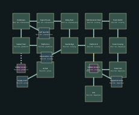

# Dead Platform — v13 design packet

Restore a physical passage across the blocked interchange.

Target: 20–25 minutes human first successful exploration, excluding deaths. No bot timing claim.

## Objective journey

1. Restore the signal-house feed to unlock the maintenance overbridge.
2. Set the far track points to move a short obstacle platform clear of the crossing.
3. Reach the civic concourse.

Train cars create close-range flank routes; platform enemies attack across tracks. No moving-train ride or escort.

These later-level diagrams establish identity and adjacency; resolve exact portal polylines, per-instance furnishings, encounter/supply numbers and collision at their subsequent construction milestone. They are not current playable replacements.

## Rooms and pre-build object list

| Room | Floor | Function | Objects |
|---|---:|---|---|
| Arrival | 0m | station | station_bench, ticket_kiosk, route_display |
| Platform A | 0m | platform | station_bench, ticket_kiosk, route_display |
| Stalled Train | 0m | station | station_bench, ticket_kiosk, route_display |
| Underpass | -3m | utility | station_bench, ticket_kiosk, route_display |
| Signal House | -3m | dispatch | station_bench, ticket_kiosk, route_display |
| Relay Stair | 1m | signal_works | station_bench, ticket_kiosk, route_display |
| Overbridge | 5m | platform | station_bench, ticket_kiosk, route_display |
| Platform B | 0m | platform | station_bench, ticket_kiosk, route_display |
| Maintenance Shed | 0m | workshop | station_bench, ticket_kiosk, route_display |
| Track Switch | 0m | signal_works | station_bench, ticket_kiosk, route_display |
| Track Crossing | -2m | platform | station_bench, ticket_kiosk, route_display |
| Ticket Hall | 0m | station | station_bench, ticket_kiosk, route_display |
| Concourse | 0m | civic_lobby | station_bench, ticket_kiosk, route_display |
| Exit | 0m | civic_lobby | station_bench, ticket_kiosk, route_display |
| Supply room (optional) | 0m | stores | station_bench, ticket_kiosk, route_display |
| Staff quarters (optional) | -3m | stores | station_bench, ticket_kiosk, route_display |
| Observation room (optional) | 5m | stores | station_bench, ticket_kiosk, route_display |
| Equipment store (optional) | 0m | stores | station_bench, ticket_kiosk, route_display |
| Hidden stores 1 (secret) | 0m | stores | station_bench, ticket_kiosk, route_display |
| Hidden stores 2 (secret) | 0m | stores | station_bench, ticket_kiosk, route_display |

Machine-readable positions, connections, requirements and inventory: `occupied_line_01.json`.
