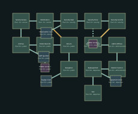

# Civic Lockdown — v13 design packet

Reroute security power and release the district exit.

Target: 20–25 minutes human first successful exploration, excluding deaths. No bot timing claim.

## Objective journey

1. Find a service credential in public records.
2. Reroute distribution power: public shutters close while the security stair opens.
3. Override security, cross the newly accessible atrium mezzanine and release the district exit.

Security rerouting changes traversal through a known landmark, with alternate service egress preventing a lock-in.

These later-level diagrams establish identity and adjacency; resolve exact portal polylines, per-instance furnishings, encounter/supply numbers and collision at their subsequent construction milestone. They are not current playable replacements.

## Rooms and pre-build object list

| Room | Floor | Function | Objects |
|---|---:|---|---|
| Reception | 0m | civic_lobby | office_desk, file_cabinet, server_rack |
| Atrium | 0m | civic_lobby | office_desk, file_cabinet, server_rack |
| Public Records | 0m | records | office_desk, file_cabinet, server_rack |
| Archive | 0m | records | office_desk, file_cabinet, server_rack |
| Service Access | -2m | utility | office_desk, file_cabinet, server_rack |
| Distribution | -2m | signal_works | office_desk, file_cabinet, server_rack |
| Security Stair | 2m | security | office_desk, file_cabinet, server_rack |
| Security Floor | 2m | security | office_desk, file_cabinet, server_rack |
| Security Control | 2m | dispatch | office_desk, file_cabinet, server_rack |
| Atrium Mezzanine | 4m | civic_lobby | office_desk, file_cabinet, server_rack |
| Admin Offices | 4m | records | office_desk, file_cabinet, server_rack |
| District Control | 4m | dispatch | office_desk, file_cabinet, server_rack |
| Released Exit | 0m | civic_lobby | office_desk, file_cabinet, server_rack |
| Exit | 0m | workshop | office_desk, file_cabinet, server_rack |
| Supply room (optional) | 0m | stores | office_desk, file_cabinet, server_rack |
| Staff quarters (optional) | 0m | stores | office_desk, file_cabinet, server_rack |
| Observation room (optional) | 2m | stores | office_desk, file_cabinet, server_rack |
| Equipment store (optional) | 0m | stores | office_desk, file_cabinet, server_rack |
| Hidden stores 1 (secret) | 0m | stores | office_desk, file_cabinet, server_rack |
| Hidden stores 2 (secret) | 2m | stores | office_desk, file_cabinet, server_rack |

Machine-readable positions, connections, requirements and inventory: `occupied_line_02.json`.
