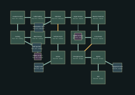

# Occupation Engine — v13 design packet

Disable the engine supports, destroy the exposed core and escape.

Target: 20–25 minutes human first successful exploration, excluding deaths. No bot timing claim.

## Objective journey

1. Isolate cooling, then disable induction to expose the core approach.
2. Destroy the exposed engine core under a sustained final encounter.
3. Use the newly opened emergency route; escape is untimed.

Finale uses existing chapter creatures and a destroyable machine, not an unplanned new boss family.

These later-level diagrams establish identity and adjacency; resolve exact portal polylines, per-instance furnishings, encounter/supply numbers and collision at their subsequent construction milestone. They are not current playable replacements.

## Rooms and pre-build object list

| Room | Floor | Function | Objects |
|---|---:|---|---|
| Access | 0m | workshop | turbine, generator, cable_drum |
| Turbine Court | 0m | power_works | turbine, generator, cable_drum |
| West Service | 0m | workshop | turbine, generator, cable_drum |
| Cooling | -2m | reactor | turbine, generator, cable_drum |
| Coolant Control | -2m | dispatch | turbine, generator, cable_drum |
| Cable Gallery | 2m | signal_works | turbine, generator, cable_drum |
| Induction | 2m | power_works | turbine, generator, cable_drum |
| Upper Service | 6m | workshop | turbine, generator, cable_drum |
| Reactor Overlook | 6m | reactor | turbine, generator, cable_drum |
| Core Access | 2m | reactor | turbine, generator, cable_drum |
| Exposed Core | 2m | reactor | turbine, generator, cable_drum |
| Emergency Exit | 0m | utility | turbine, generator, cable_drum |
| Egress | 0m | workshop | turbine, generator, cable_drum |
| Exit | 0m | station | turbine, generator, cable_drum |
| Supply room (optional) | 0m | stores | turbine, generator, cable_drum |
| Staff quarters (optional) | -2m | stores | turbine, generator, cable_drum |
| Observation room (optional) | 2m | stores | turbine, generator, cable_drum |
| Equipment store (optional) | 0m | stores | turbine, generator, cable_drum |
| Hidden stores 1 (secret) | 0m | stores | turbine, generator, cable_drum |
| Hidden stores 2 (secret) | 6m | stores | turbine, generator, cable_drum |

Machine-readable positions, connections, requirements and inventory: `occupied_line_03.json`.
