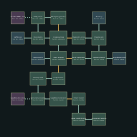

# Intake — v13 design packet

Restore local power in the utility generator room.

Target: 20–25 minutes human first successful exploration, excluding deaths. No bot timing claim.

## Required objective journey

- Restore local power in the utility generator room. Requires: arrival; completion flag: `local_power`.
- Find the surgical credential in the operating theatre. Requires: local_power; completion flag: `surgical_credential`.
- Reach the surgical wing and survive decontamination. Requires: surgical_credential; completion flag: `decon_clear`.
- Take the transfer lift to Containment. Requires: decon_clear; completion flag: `finished`.

## Checkpoints

- `power_return` in reception, after local_power.
- `credential_return` in sterile, after surgical_credential.

Encounter roster: 64 existing Ward enemies. Main-route ammunition pickups: {'pistol': 220, 'shells': 90, 'rivets': 0, 'rockets': 0}. Optional supplies are separate.

## Rooms and pre-build object list

| Room | Floor | Function | Objects |
|---|---:|---|---|
| Patient reception | 0m | triage_reception | intake_desk, intake_desk, waiting_bench, waiting_bench, waiting_bench, records_cabinet, records_cabinet, containment_console |
| Emergency triage | 0m | triage_ward | medical_bed, medical_bed, medical_bed, medical_bed, medical_bed, medical_bed, medical_bed, medical_bed, vital_monitor, vital_monitor, vital_monitor, vital_monitor, privacy_screen, privacy_screen, privacy_screen, privacy_screen, medical_cabinet, medical_cabinet |
| Nurse station | 0m | control_room | containment_console, containment_console, containment_console, containment_console, records_cabinet, records_cabinet |
| Utility service | -2m | utility | pump_rig, pump_rig, pump_rig, pump_rig, pipe_manifold, pipe_manifold, filter_unit, containment_console |
| Emergency generator | -2m | utility | pump_rig, pump_rig, pump_rig, pump_rig, pipe_manifold, pipe_manifold, filter_unit, containment_console |
| Diagnostics access | 2m | diagnostics | scan_console, scan_console, instrument_bench, instrument_bench, specimen_fridge, specimen_fridge, medical_cabinet, medical_cabinet |
| Imaging suite | 2m | diagnostics | scan_console, scan_console, instrument_bench, instrument_bench, specimen_fridge, specimen_fridge, medical_cabinet, medical_cabinet |
| Operating theatre | 2m | surgery | surgical_table, surgical_table, surgical_lamp, surgical_lamp, instrument_bench, instrument_bench, specimen_fridge, medical_cabinet, vital_monitor, vital_monitor |
| Sterile supply return | 2m | medical_stores | medical_cabinet, medical_cabinet, medical_cabinet, medical_cabinet, medical_cabinet, medical_cabinet, medical_cabinet, medical_cabinet, supply_cart, supply_cart |
| Surgical access | 2m | decontamination | filter_unit, filter_unit, decon_frame, decon_frame, ppe_locker, ppe_locker, pipe_manifold, pipe_manifold |
| Recovery ward | 2m | triage_ward | medical_bed, medical_bed, medical_bed, medical_bed, medical_bed, medical_bed, medical_bed, medical_bed, vital_monitor, vital_monitor, vital_monitor, vital_monitor, privacy_screen, privacy_screen, privacy_screen, privacy_screen, medical_cabinet, medical_cabinet |
| Instrument processing | 2m | medical_stores | medical_cabinet, medical_cabinet, medical_cabinet, medical_cabinet, medical_cabinet, medical_cabinet, medical_cabinet, medical_cabinet, supply_cart, supply_cart |
| Sealed decontamination | 2m | decontamination | filter_unit, filter_unit, decon_frame, decon_frame, ppe_locker, ppe_locker, pipe_manifold, pipe_manifold |
| Patient transfer | 4m | utility | pump_rig, pump_rig, pump_rig, pump_rig, pipe_manifold, pipe_manifold, filter_unit, containment_console |
| Upper transfer landing | 4m | utility | pump_rig, pump_rig, pump_rig, pump_rig, pipe_manifold, pipe_manifold, filter_unit, containment_console |
| Containment receiving | 6m | security | intake_desk, security_console, weapon_rack, weapon_rack, ppe_locker, ppe_locker |
| Patient records (optional) | 0m | records | records_cabinet, records_cabinet, records_cabinet, records_cabinet |
| Staff lockers (optional) | 0m | staff_room | ppe_locker, ppe_locker, ppe_locker, ppe_locker |
| Pharmacy (optional) | 2m | medical_stores | medical_cabinet, medical_cabinet, medical_cabinet, medical_cabinet |
| Surgical observation (optional) | 4m | control_room | containment_console, containment_console, containment_console, containment_console |
| Abandoned filter crawl (secret) | -2m | utility | pump_rig, pump_rig, pump_rig, pump_rig |
| Sealed isolation stores (secret) | 2m | medical_stores | medical_cabinet, medical_cabinet, medical_cabinet, medical_cabinet |

Machine-readable positions, connections, requirements and inventory: `pale_ward_01.json`.

## Structural combat connection — construction revision

`triage_nurse_court`: Ungated shared combat court replaces existing ungated connector; no new graph edge. Split ledge preserves3.5m ground axis.

Constructed geometry remains subject to independent physical, contact, order, checkpoint and gameplay review. Existing objectives, checkpoints and actor budgets/IDs are preserved.

| Aperture | Plane | Horizontal span | Absolute height |
|---|---:|---|---|
| triage W | -17m | [-49, -31]m | [0, 5.5]m |
| nurse E | -27m | [-49, -31]m | [0, 5.5]m |

Closed structural volumes and physical cover:
- `CourtFloor`: centre `[-22, -0.25, -40]`, size `[10.4, 0.5, 18.4]`m, native floor surfaces.
- `CourtRoof`: centre `[-22, 5.65, -40]`, size `[10.8, 0.3, 18.8]`m, native ceiling surfaces.
- `CourtNorth`: centre `[-22, 2.75, -49.2]`, size `[10.4, 5.5, 0.4]`m, native wall surfaces.
- `CourtSouth`: centre `[-22, 2.75, -30.8]`, size `[10.4, 5.5, 0.4]`m, native wall surfaces.
- `NorthCover`: centre `[-22, 0.7, -45]`, size `[2.5, 1.4, 1.8]`m, native panel surfaces.
- `SouthCover`: centre `[-22, 0.7, -35]`, size `[2.5, 1.4, 1.8]`m, native panel surfaces.
- `NorthLedge`: centre `[-28.5, 0.625, -44.125]`, size `[3, 1.25, 4.75]`m, native floor surfaces.
- `SouthLedge`: centre `[-28.5, 0.625, -35.875]`, size `[3, 1.25, 4.75]`m, native floor surfaces.
- `NorthStair`: floor `[-28.5, 0, -51.5]` to `[-28.5, 1.25, -46.5]`, width 3m; ten0.125m risers over5m run (0.5m tread). Actual ascent/descent is a separate evidence gate.
- `SouthStair`: floor `[-28.5, 0, -28.5]` to `[-28.5, 1.25, -33.5]`, width 3m; ten0.125m risers over5m run (0.5m tread). Actual ascent/descent is a separate evidence gate.
- Existing actor `pale_ward_01.nurse.enemy.2` (infected_security) moved to `[-28.5, 2.12, -43]`; Supported elevated cross-area angle;13.51m horizontal to triage test stance.

Lane contract: `{"north_south_physical_width_m": 3.1, "actual_capsule_diameter_m": 0.6, "usable_capsule_center_width_m": 2.5, "central_ground_passage_width_m": 3.5, "enemy_navigation": "Existing centre route; flanks are player choices, not coordinated AI lanes."}`.

Risks and unfinished acceptance:
- Ten existing actors may now share early engagement; gameplay fairness and checkpoint safety require fresh evidence.
- No collision-only anti-bypass; every solid is a matching visible closed mesh.

Exact floor paths, shot/solid test pairs, apertures, closed boxes and actor poses are recorded in `levels.json`, the matching Ward JSON, runtime route and v13 author report. These data are a test contract, not proof that the test passed.
