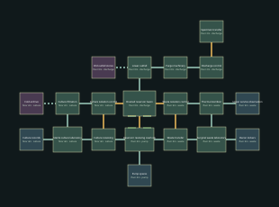

# Containment — v13 design packet

Isolate the culture reservoir feed.

Target: 20–25 minutes human first successful exploration, excluding deaths. No bot timing claim.

## Required objective journey

- Isolate the culture reservoir feed. Requires: arrival; completion flag: `isolation_a`.
- Isolate the surgical-waste reservoir feed. Requires: arrival; completion flag: `isolation_b`.
- Descend into the drained basin and reach specimen transfer. Requires: isolation_a, isolation_b; completion flag: `finished`.

## Checkpoints

- `culture_safe` in isolation_a, after isolation_a.
- `waste_safe` in isolation_b, after isolation_b.

Encounter roster: 76 existing Ward enemies. Main-route ammunition pickups: {'pistol': 180, 'shells': 80, 'rivets': 180, 'rockets': 0}. Optional supplies are separate.

## Rooms and pre-build object list

| Room | Floor | Function | Objects |
|---|---:|---|---|
| Reservoir receiving overlook | 4m | control_room | containment_console, containment_console, containment_console, containment_console, records_cabinet, records_cabinet |
| Culture receiving | 4m | diagnostics | scan_console, scan_console, instrument_bench, instrument_bench, specimen_fridge, specimen_fridge, medical_cabinet, medical_cabinet |
| Sterile culture laboratory | 4m | surgery | surgical_table, surgical_table, surgical_lamp, surgical_lamp, instrument_bench, instrument_bench, specimen_fridge, medical_cabinet, vital_monitor, vital_monitor |
| Culture filtration | 2m | utility | pump_rig, pump_rig, pump_rig, pump_rig, pipe_manifold, pipe_manifold, filter_unit, containment_console |
| Culture isolation control | 2m | control_room | containment_console, containment_console, containment_console, containment_console, records_cabinet, records_cabinet |
| Waste transfer | 4m | utility | pump_rig, pump_rig, pump_rig, pump_rig, pipe_manifold, pipe_manifold, filter_unit, containment_console |
| Surgical waste laboratory | 4m | surgery | surgical_table, surgical_table, surgical_lamp, surgical_lamp, instrument_bench, instrument_bench, specimen_fridge, medical_cabinet, vital_monitor, vital_monitor |
| Thermal sterilizer | 6m | utility | pump_rig, pump_rig, pump_rig, pump_rig, pipe_manifold, pipe_manifold, filter_unit, containment_console |
| Waste isolation control | 6m | control_room | containment_console, containment_console, containment_console, containment_console, records_cabinet, records_cabinet |
| Drained reservoir basin | 0m | reservoir | specimen_tank, specimen_tank, specimen_tank, specimen_tank, pipe_manifold, pipe_manifold |
| Lower outfall | 0m | utility | pump_rig, pump_rig, pump_rig, pump_rig, pipe_manifold, pipe_manifold, filter_unit, containment_console |
| Purge machinery | 0m | utility | pump_rig, pump_rig, pump_rig, pump_rig, pipe_manifold, pipe_manifold, filter_unit, containment_console |
| Discharge control | 2m | control_room | containment_console, containment_console, containment_console, containment_console, records_cabinet, records_cabinet |
| Specimen transfer | 2m | security | intake_desk, security_console, weapon_rack, weapon_rack, ppe_locker, ppe_locker |
| Pump spares (optional) | 4m | utility | pump_rig, pump_rig, pump_rig, pump_rig |
| Culture records (optional) | 4m | records | records_cabinet, records_cabinet, records_cabinet, records_cabinet |
| Decon lockers (optional) | 4m | staff_room | ppe_locker, ppe_locker, ppe_locker, ppe_locker |
| Upper service observation (optional) | 6m | control_room | containment_console, containment_console, containment_console, containment_console |
| Cold archive (secret) | 2m | medical_stores | medical_cabinet, medical_cabinet, medical_cabinet, medical_cabinet |
| Old outfall stores (secret) | 0m | utility | pump_rig, pump_rig, pump_rig, pump_rig |

Machine-readable positions, connections, requirements and inventory: `pale_ward_02.json`.
