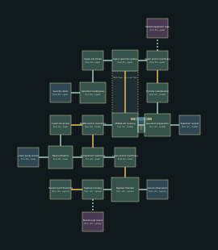

# Breach — v13 design packet

Destroy the upper containment anchor.

Target: 20–25 minutes human first successful exploration, excluding deaths. No bot timing claim.

## Required objective journey

- Destroy the upper containment anchor. Requires: arrival; completion flag: `anchor_a`.
- Descend to the middle silo and destroy its anchor. Requires: anchor_a; completion flag: `anchor_b`.
- Destroy the deep containment anchor. Requires: anchor_b; completion flag: `anchor_c`.
- Cross the rupture and enter the buried passage. Requires: anchor_c; completion flag: `finished`.

## Checkpoints

- `upper_anchor_safe` in anchor_a, after anchor_a.
- `middle_anchor_safe` in anchor_b, after anchor_b.

Encounter roster: 84 existing Ward enemies. Main-route ammunition pickups: {'pistol': 160, 'shells': 80, 'rivets': 120, 'rockets': 20}. Optional supplies are separate.

## Rooms and pre-build object list

| Room | Floor | Function | Objects |
|---|---:|---|---|
| Specimen loading bay | 8m | security | intake_desk, weapon_rack |
| Upper silo intake | 8m | utility | filter_unit, supply_cart |
| Upper specimen gallery | 8m | specimen_silo | specimen_tank, instrument_bench |
| Upper anchor machinery | 8m | utility | filter_unit, supply_cart |
| Transfer maintenance | 6m | utility | filter_unit, supply_cart |
| Specimen preparation | 4m | surgery | surgical_table, instrument_bench, surgical_lamp |
| Middle silo crossing | 4m | specimen_silo | specimen_tank, instrument_bench |
| Middle anchor machinery | 4m | utility | filter_unit, supply_cart |
| Lower silo access | 2m | utility | filter_unit, supply_cart |
| Deep cultivation | 0m | reservoir | filter_unit, containment_console |
| Containment machinery | 0m | utility | filter_unit, supply_cart |
| Lower anchor machinery | 0m | utility | filter_unit, supply_cart |
| Rupture chamber | -4m | specimen_silo | specimen_tank, instrument_bench |
| Rupture crossing | -4m | utility | filter_unit, supply_cart |
| Buried occult threshold | -4m | security | intake_desk, weapon_rack |
| Security stores (optional) | 8m | security | intake_desk, weapon_rack |
| Specimen records (optional) | 4m | records | records_cabinet, records_cabinet |
| Lower pump service (optional) | 0m | utility | filter_unit, supply_cart |
| Fissure observation (optional) | -2m | control_room | containment_console, records_cabinet |
| Sealed equipment cage (secret) | 8m | utility | filter_unit, supply_cart |
| Buried crypt recess (secret) | -4m | utility | filter_unit, supply_cart |

Machine-readable positions, connections, requirements and inventory: `pale_ward_03.json`.
